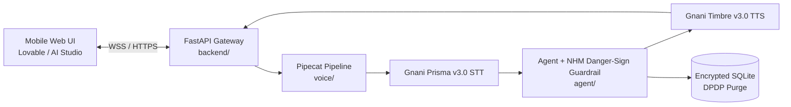

# SwasthyaVaani — Voice Field Register for ASHA Workers

**Gnani Voice Hackathon — Track 1 (PS1 Healthcare)**

## Overview
Real-time streaming voice agent that turns an ASHA worker's spoken home-visit notes (Indic languages + English code-mix under household/street noise) into a structured visit record and follow-up list with zero typing, voice read-back/correction, and immediate PHC danger-sign escalation.

## Architecture
<!-- Update Mermaid diagram as implementation progresses -->


## Gnani API Platform Services Used
- **STT:** Gnani Prisma v3.0 (WebSocket streaming)
- **TTS:** Gnani Timbre v3.0 (WebSocket streaming, standard voices only)
- **Orchestration:** Pipecat custom streaming pipeline

## Danger-Sign Protocol Citation
Fixed danger-sign list (`contracts/danger_signs.json`) is sourced from:
> **National Health Mission (NHM), MoHFW, Government of India — ASHA Training Modules 6 & 7 (*Skills that Save Lives*) and Home-Based Newborn Care (HBNC) Operational Guidelines.**
> https://nhm.gov.in/index1.php?lang=1&level=3&sublinkid=184&lid=257

## Responsible AI & DPDP Compliance
- First-turn AI disclosure in the active Indic language (`contracts/languages.json`).
- Zero diagnosis, treatment, or dosage advice (PHC referral only).
- Synthetic beneficiaries only (`SYN-ASHA-*`); encrypted at rest with Fernet; post-judging purge via `DELETE /api/admin/purge`.
- API keys stored strictly in `.env` (gitignored). No voice cloning.

## Team Ownership
| Zone | Owner | Scope | Branch Prefix |
| :--- | :--- | :--- | :--- |
| **Zone A** | Backend Dev 1 | `voice/`, `backend/routers/ws.py` | `feat/voice-*` |
| **Zone B** | Backend Dev 2 | `agent/`, `backend/db.py`, `backend/crypto.py`, `backend/routers/records.py`, `data/`, `scripts/` | `feat/agent-db-*` |
| **External UI** | Frontend Dev | Lovable / Google AI Studio (`docs/frontend_handoff_prompt.md`) | External |
| **Frozen** | Sync all 3 first | `contracts/`, `AGENTS.md`, `.agents/rules/`, `backend/main.py` | Review by both devs |

## Setup
```bash
# 1. Clone the repo and enter the directory
cd Newton_PS

# 2. Create virtual environment
python -m venv .venv
# Windows:
.venv\Scripts\activate
# Linux/Mac:
# source .venv/bin/activate

# 3. Install dependencies
pip install -r requirements.txt

# 4. Configure environment
cp .env.example .env
# Edit .env with your actual API keys

# 5. Generate a Fernet encryption key (paste into .env ENCRYPTION_KEY)
python -c "from cryptography.fernet import Fernet; print(Fernet.generate_key().decode())"

# 6. Seed synthetic beneficiary data
python -m scripts.seed_db

# 7. Run automated test suite
pytest tests/ -v

# 8. Run the simulator test harness
python -m scripts.test_voice_session --text "Priya Devi ka ANC visit, weight 55 kg, bleeding ho rahi hai"

# 9. Run the server
uvicorn backend.main:app --host 0.0.0.0 --port 8000 --reload
```

## Hackathon Presentation & Deliverables Pack
- **Pitch Deck (6 Slides):** [docs/pitch_deck.md](docs/pitch_deck.md)
- **Demo Video Script (2.5 mins):** [docs/demo_video_guide.md](docs/demo_video_guide.md)
- **Live Judge Demo Scenarios:** [docs/live_judge_demo_script.md](docs/live_judge_demo_script.md)
- **Frontend Handoff Guide:** [docs/frontend_handoff_prompt.md](docs/frontend_handoff_prompt.md)

